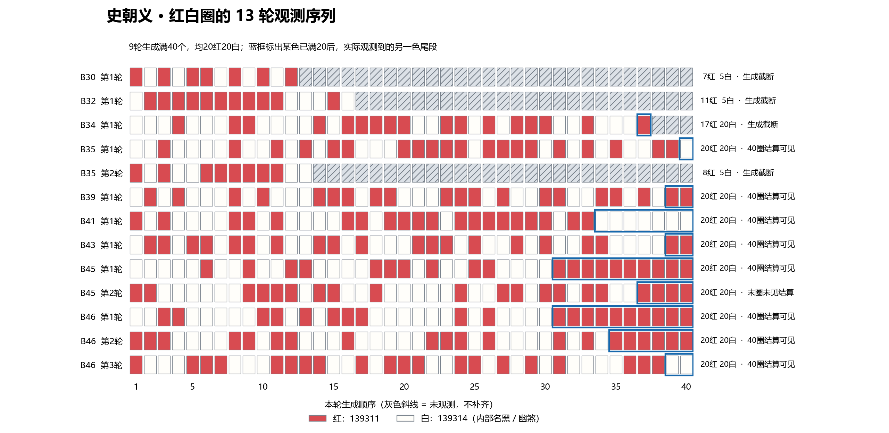

# 体验服史朝义红白圈

本批 **25 人普通洛阳之战（地图 835），2026-09-15 体验服**记录中：

- 红圈的 NPC 模板 ID 是 **139311**；另一色圈是 **139314**。后者的内部名称是「黑圈／幽煞」，本文按玩家称呼写作「白圈」。日志本身不含圈的截图或实际颜色像素。
- 前置读条是 **45711「戾芒天坠」**，内部名「煞气分流读条」，配置为 2 秒。不是 45724「戾煞」。
- 共 **46 场史朝义战斗，9 场到达该机制，13 轮，438 个圈**。37 场没有到达；6 场出现 1 轮，2 场出现 2 轮，1 场出现 3 轮。
- **9 轮生成满 40 个圈，全部恰好 20 红、20 白**。其中 8 轮看到了全部圈的判定／爆炸事件；另 1 轮的最后一个圈在重置时提前消失，未见结算。
- 另有 **4 轮在生成第 12、16、37、13 个圈后截断**；均有首领退场及重伤／重置证据。没有把未生成部分补齐。
- 颜色顺序更符合 **“两色都未满 20 时近似等概率随机；某色满 20 后，余下补另一色”**，而非均匀打乱一副 20 红 20 白的牌。这里是数据支持的候选模型，未获得服务器生成算法。
- 空间上，全部圈落在首领初始坐标周围 **28 尺**以内，同轮出生点两两间距均超过 **4 尺**。这支持“固定圆域内、保留最小间距”的候选生成规则。

## 统计复核

1. **没有显著的白色优势或连续同色优势。** 去补齐后白率52.16%、同色转移率51.05%，定向p分别0.198、0.346。仍容许小幅偏白和较弱的连续性，不能写成“已证明公平iid”。
2. **拒绝“各点独立地在28尺圆内按面积均匀生成”。** 它通常留下129–178对不足4尺的点，本批为0对；单轮也能拒绝，无需先假定跨轮独立。
3. **“面积均匀提议新点，再避开本轮所有旧点的4尺范围”与数据相容。** 只避最近7／8点不够；均匀抽半径再避让的模型也不符。
4. **“三套固定40点图形，只随机旋转、重排生成顺序”不符。** 9轮完整点集两两均不同。粗略形状加大扰动、形状内部再次随机采样仍不能排除。
5. **未发现可靠的跨轮颜色、半径或角度关联。** 同场相邻轮只有4对，检验能力有限。

425 对时间相邻的圈中，最短距离为 4.068 尺。B34 第一轮第 12、13 圈相隔 0.776 秒，距离 4.06791 尺。同一场战斗的轮次共享团队和进度，跨轮检验的样本量有限。

[逐圈坐标及时间](evidence.json) · [运行说明](../README.md)
