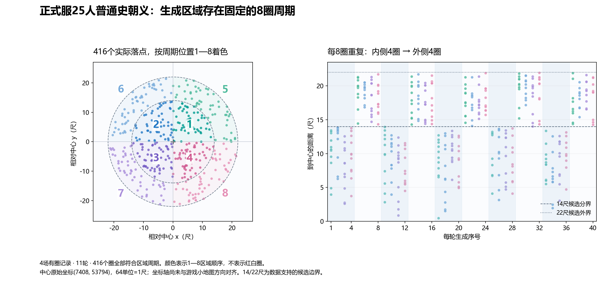

# 正式服25人普通史朝义红白圈生成坐标研究

截至2026年11月4日本次检索，可访问原始JCL中共有5份去重后的正式服25人普通史朝义相关记录；其中4场出现踩圈，共11轮、416个圈。**416个圈全部遵循同一生成区域顺序：内侧四象限依次生成，再到外侧四象限依次生成，每8个圈重复。** 每个区域内的具体落点会变化，红白颜色也没有固定绑定区域。

这与9月15日体验服样本的结论不同。正式服生成范围支持约22尺外界、14尺内外分界；同轮已消失圈的附近可以再次生成，仍然存在的圈之间则观测到约4尺的最小间距约束。



## 样本范围

检索了本机游戏日志、下载目录、当前仓库和其他工作树等8个根目录，共11130条JCL路径。洛阳记录295条路径中，219条为体验服、43条为正式服10人、33条为正式服25人普通。先以原始类型1头部的`zhcn_hd`和地图`835`筛选，再以本体NPC模板`139312`识别史朝义，最终保留5份不同SHA256的记录，另有6份相同内容的副本。其余22条正式25人普通路径为其他首领记录。文件名不是唯一识别依据。

| 记录 | 日志开始时间 | 踩圈轮次 | 各轮圈数 | 总圈数 |
|---|---|---:|---|---:|
| L001 | 11月2日 20:22:47 | 0 | 未进入机制 | 0 |
| L002 | 11月2日 20:23:43 | 2 | 40、35 | 75 |
| L003 | 11月2日 20:55:19 | 3 | 40、40、21 | 101 |
| L004 | 11月3日 20:43:35 | 3 | 40、40、40 | 120 |
| L005 | 11月3日 21:08:06 | 3 | 40、40、40 | 120 |
| 合计 | 2026年11月2日至3日 | 11 | 9轮完整生成、2轮不足40 | 416 |

时间按游戏原日志UTC+8列出。L001文件名为“李复”，但原始记录包含史朝义本体进战和技能，因此保留在记录分母中；该短记录时长28.094秒。两轮不足40均保留实际生成数量，不补齐，也不据此认定团灭；L002与L003均存在后续击败史朝义的系统文本。

这里的“截至现在”指本次检索能够访问的原始JCL；最新记录日期是11月3日。不包含服务器全站所有玩家记录：现有服务器上传路径存储的是派生统计，并不提供这里所需的完整原始生成坐标。五场入选日志的 SHA256 可从[战斗样本](evidence.json)核对。

## 坐标定义与完整明细

五份记录中，史朝义首次位置均为原始坐标`(7408,53794)`。以它为中心，平面坐标换算为：

```text
X = (原始x - 7408) / 64
Y = (原始y - 53794) / 64
r = sqrt(X² + Y²)
θ = atan2(Y, X)，归一化到0至360度
```

X、Y、r的单位均为尺，不把高度z混入平面距离。本研究以 64 个世界平面坐标单位折算 1 尺。

416圈的原始x范围为`6046–8776`，y范围为`52439–55163`，416个不同的(x,y)没有完全重复。逐圈坐标、原始描述行号、入场和退场时间、颜色、轮次及序号已完整保存在[机制样本](evidence.json)。[全部11轮坐标图](all-waves.png)标有每个圈的序号和红白颜色。

圈坐标取首次类型8 NPC描述的x/y，时间取类型6入场；416个圈的描述与入场全部同帧，402个同毫秒、14个相差1毫秒。因此本批坐标有直接的生成入场证据。独立解析器逐圈复核15个字段，与主提取结果零差异。

## 每8圈重复的区域顺序

下表“右上”等仅指本报告坐标图中的方向，尚未与游戏小地图的东南西北对齐。角度从+x轴沿数学正方向增加，各象限按半开区间划分；样本中存在恰在+x轴上的点。

| 周期位置 | 本轮生成序号 | 坐标图中的区域 | 候选距离范围 | 点数 | 实测距离范围 |
|---:|---|---|---|---:|---|
| 1 | 1、9、17、25、33 | 右上，0–90度 | 内侧，0–14尺 | 53 | 0.476–13.958尺 |
| 2 | 2、10、18、26、34 | 左上，90–180度 | 内侧，0–14尺 | 53 | 1.502–13.879尺 |
| 3 | 3、11、19、27、35 | 左下，180–270度 | 内侧，0–14尺 | 53 | 0.869–13.431尺 |
| 4 | 4、12、20、28、36 | 右下，270–360度 | 内侧，0–14尺 | 52 | 3.748–13.753尺 |
| 5 | 5、13、21、29、37 | 右上，0–90度 | 外侧，14–22尺 | 52 | 14.321–21.904尺 |
| 6 | 6、14、22、30、38 | 左上，90–180度 | 外侧，14–22尺 | 51 | 14.086–21.723尺 |
| 7 | 7、15、23、31、39 | 左下，180–270度 | 外侧，14–22尺 | 51 | 14.002–21.619尺 |
| 8 | 8、16、24、32、40 | 右下，270–360度 | 外侧，14–22尺 | 51 | 14.290–21.957尺 |

**11轮全部从周期位置1重新开始，416/416符合，没有区域或内外顺序违例。** 最先检查的两场221圈用于发现规律；随后加入的另外两场195圈也全部符合。后者是追加核验，不包装成预注册的独立实验。

内侧最外点13.9584尺，外侧最内点14.0022尺，所有点最外21.9568尺，非常贴近14和22这两个整尺边界。这支持以14/22尺表示机制，但具体服务器常量尚未直接读取。

同一区域包含51至53个不同坐标，角度分布接近覆盖整个象限，不能将它简化为八个固定落点。完整40圈恰好是5个八圈周期。相隔8圈会回到同一区域，平均距离8.06尺；相邻圈则移到下一象限，平均距离18.99尺，因此“隔一段时间回到刚才附近”有明确的周期原因。

## 近距离复用与仍存在的圈

| 点对范围 | 点对数 | 距离小于4尺 | 最短距离 |
|---|---:|---:|---:|
| 同轮所有圈 | 7825 | 213 | 0.2868尺 |
| 入退场时间显示同时存在 | 2590 | 0 | 4.0661尺 |

213对近距离点对中，同色93对、异色120对，全部发生在旧圈退场之后。因此正式服允许复用已经空出来的附近位置，颜色不是复用限制的分界。

最明显的例子是L003第2轮第9与第25圈：均为红圈，相隔12.030秒，落点只差0.2868尺；第9圈已退场6.177秒。原始坐标行分别是212831和221905。最近的同时存在点对则是同轮第35红圈与第36白圈，距离4.0661尺。

为了区分“区域顺序本身让点分开”与额外避让，模拟固定实际11轮长度、8区域顺序和日志观测的圈生存关系，只改变区域内落点生成方式。每个候选模型模拟10000次，随机种子为2026110408起。

| 候选模型 | 同时存在且不足4尺的点对 | 与本批记录的关系 |
|---|---|---|
| 每个指定区域内按面积独立抽点，不避让 | 平均20.57对，95%模拟参考区间12–30对 | 10000次均未达到实测的0对 |
| 指定区域内按面积提议，离仍存在圈不足4尺则重抽 | 强制为0对；最小间距95%参考4.001–4.220尺 | 实测4.066尺及径向、角向统计均相容 |
| 指定区域内半径均匀提议，再做4尺避让 | 径向分布明显偏向区域内缘 | 与实测径向分布不相容 |

不避让模型的单侧加一模拟p约0.00010；零命中对应的模拟尾概率单侧95%上界约0.00030，不记作p=0。面积提议加避让模型的径向、角向KS诊断p分别约0.754和0.489。区域内面积分数定义为`u=(r²-r_min²)/(r_max²-r_min²)`；观测平均u=0.4883，而半径均匀提议加避让模型平均约0.4217，双侧加一p约0.00020。

这些结果支持“分区域生成，并保留约4尺的活跃圈间距”的候选解释，不等于恢复了服务器代码。14、22、4均是机制候选参数，模拟固定观测长度和生命周期，未建模通关截断、同团队相关性及整数坐标量化。部分日志出现圈事件集中到达，新圈出现时旧圈数量并非始终7个，不能把生命周期规则写死为“只看最近7圈”。本研究也未穷举其他具有短期记忆的生成算法。

## 颜色与时间

总计209红、207白；9轮完整40圈均为20红20白，另外两轮为18红17白、11红10白。红圈模板`139311`，白圈模板`139314`；“白”沿用玩家视觉称呼，内部资料称黑圈或幽煞。

八个生成区域均实际出现过红、白两色，所以不能根据区域固定预测颜色。这里没有把“区域顺序固定”扩展成“颜色独立随机”的结论。

以技能`45711`读条开始分轮，首圈延迟2.463–2.569秒。相邻生成事件间隔中位数0.749秒、均值0.752秒，对应一个八圈周期通常约6秒。部分记录有0至2.698秒的事件间隔，时间上有日志集中到达或节奏波动，因此不能把每个相邻事件都当成精确0.75秒。

## 对机制判断的意义

可以按“四象限轮转、内四外四”的8步周期预判下一圈的大区域；走完第8个后回到内侧第1区域。一轮40个圈重复5次。区域内具体落点和颜色仍需观察，不能提前认定某一个精确坐标或颜色。

此前体验服的“28尺圆域、整轮所有点保持4尺间距”不适用于这批正式服。正式服数据中既有22尺附近的清晰外界，也有213对旧圈消失后的近距离重用，必须按本次版本单独处理。


## 复核方法

[样本与运行命令](../README.md)
